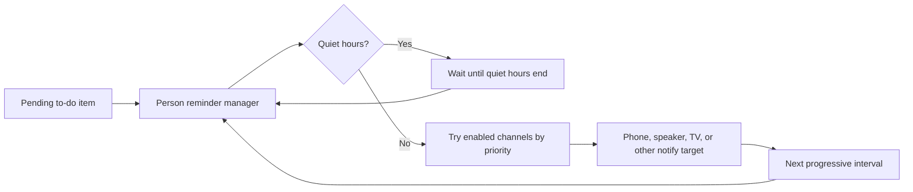
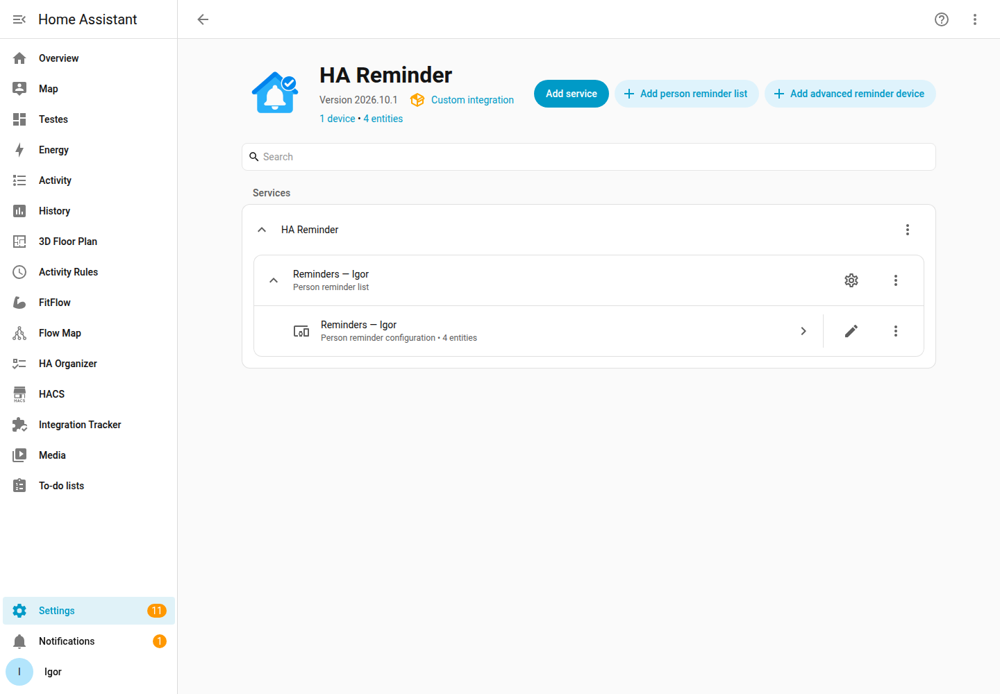
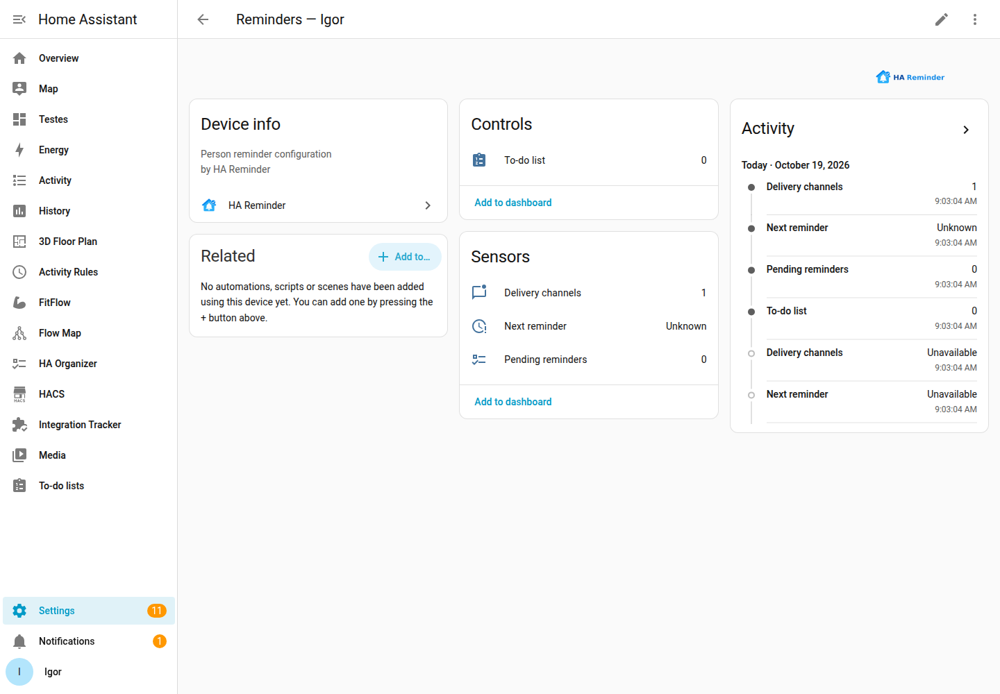

# HA Reminder

HA Reminder turns each item in a person's local reminder list into a persistent reminder. It also provides dedicated devices for shared or recurring advanced reminders. Delivery stays script-based, so the integration does not need to know whether a script reaches a phone, television, speaker, or another surface.

## Features

- A dedicated `todo` list, pending-count sensor, and next-reminder sensor for every configured person.
- Independent progressive schedules, due-date scheduling (date-only is 09:00), quiet hours, and retry handling.
- Script-only notification channels with per-person priority, fallback, equal-priority round robin, a five-second response timeout, and global five-second channel throttling.
- Local persistent state that is reconciled after Home Assistant restarts.
- Advanced reminder devices with enable and daily-completion switches, status,
  notification-level and next-occurrence sensors, recurrence, independent
  delivery for each recipient, and shared completion.

## How it works

Each person device exposes three sensors: pending reminders, next reminder, and
delivery channels. The delivery-channel sensor reports the configured channel
count and includes each channel's name, priority, and script entity ID in its
attributes.

### See it in Home Assistant

The integration page groups the person list and its reminder device together:

The person device contains the to-do list and all three sensors, including the
delivery-channel count:

The first setup flow is also captured in this short demo:

Creating an advanced reminder and viewing its device sensors:

Creating a notification-channel script from the blueprint, linking it to a person, and testing it:

## Marketplace availability

This integration is available in Marketplace's default catalog. In Home Assistant, open
the Marketplace, search for **HA Reminder**, install it, and restart Home
Assistant. Manual installation is also supported: copy `custom_components/ha_reminder` to
your Home Assistant configuration directory.

## Configuration and use

Add **HA Reminder** once from Settings → Devices & services. On its integration page, choose the
**Add person reminder list** button to set up a person's reminder list and delivery policy. The
integration creates a device named `Reminders — <person>`, a `todo.reminders_<person>` list, and
three sensors.

Create pending items in that to-do list as usual. Completing or deleting an item stops its future deliveries. Configure notification channels through the integration options; each channel is a `script.*` that receives the documented payload and returns `{success: true}` when it has dispatched the message.

For a built-in Home Assistant notification, import the included [notification-channel script blueprint](blueprints/script/ha_reminder/notification_channel.yaml), create the script, and add the generated `script.*` as a channel in the person's HA Reminder options. The generated script remains editable, so you can customize its title, message, or notification data. It creates a persistent notification in Home Assistant, includes the received payload as JSON for inspection, marks a manual channel test with `is_test: true`, shows high and critical levels in the title, and returns the required response after Home Assistant accepts the notification action.

The blueprint is also suitable as the default test channel because it creates a persistent
notification inside Home Assistant and implements the `{success: true}` response expected by
HA Reminder.

Choose **Add advanced reminder device** on that same page to create a device for a one-time or
recurring household reminder. Select recipients from the people already configured in HA Reminder,
define its notification level and schedule, then use its enable and **Completed today**
switches and device sensors. For an exact time, enable **Continue alerts after exact
time** to repeat notifications through the day or until completion. The configuration
form shows only fields relevant to the selected schedule. Call
`ha_reminder.interact` with `interaction: complete` to complete the active occurrence from an
automation, script, actionable notification, or another Home Assistant surface. Snooze and
acknowledgement actions are reserved for a future release.

## Technical documentation

- [Channel contract and scheduling behavior](docs/architecture.md)
- [Notification-channel script blueprint](blueprints/script/ha_reminder/notification_channel.yaml)
- [Compatibility](docs/compatibility.md)
- [Development and validation](docs/development.md)
- [Changelog](CHANGELOG.md)
